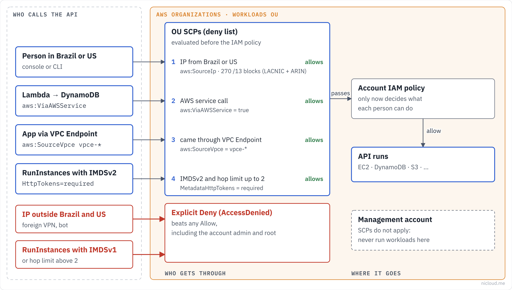

# aws-scp-advanced-library

Service control policies (SCPs) for AWS Organizations, each one validated by IAM Access Analyzer and covered by automated tests that simulate what it blocks and what it must keep working.



## Policies

| Policy | What it enforces | Size (minified) |
|---|---|---|
| [region-restriction](policies/region-restriction/) | Only `us-east-1` and `sa-east-1`; global services keep working | 1,094 |
| [iam-lockdown](policies/iam-lockdown/) | No IAM users or access keys, protected platform roles, CloudTrail/Config/GuardDuty/Security Hub cannot be turned off, no leaving the organization, no root user | 2,012 |
| [require-encryption](policies/require-encryption/) | TLS for S3, approved S3 encryption, encrypted EBS, RDS and EFS | 1,213 |
| [tag-enforcement](policies/tag-enforcement/) | `owner`, `cost-center` and `environment` on EC2, EBS, RDS and Lambda | 1,606 |
| [imdsv2-enforcement](policies/imdsv2-enforcement/) | IMDSv2 and hop limit 2 on new instances | 439 |
| [geo-restriction](policies/geo-restriction/) | API calls only from Brazilian and US IP blocks | 4,691 |

All policies are deny lists: attach them next to the default `FullAWSAccess` SCP. Platform roles (`OrganizationAccountAccessRole`, `AWSControlTowerExecution`, `break-glass-admin`) are exempt where it makes sense, so the platform team can always recover an account.

## Quick start

```bash
# create the policy (minified, because the CLI counts whitespace)
aws organizations create-policy \
  --name region-restriction \
  --type SERVICE_CONTROL_POLICY \
  --description "Only us-east-1 and sa-east-1" \
  --content "$(jq -c . policies/region-restriction/deny-non-approved-regions.json)"

# attach it to an OU (start with a sandbox OU)
aws organizations attach-policy --policy-id p-xxxxxxxx --target-id ou-xxxx-xxxxxxxx
```

Roll out one policy at a time, first to a sandbox OU, and watch CloudTrail for `AccessDenied` with `explicit deny in a service control policy` before moving to production OUs.

## Tests

```bash
pip install pytest
pytest
```

- `tests/test_structure.py`: every policy is valid SCP syntax (version, unique Sids, deny only, no `Principal`) and fits the 10,240-character quota when minified.
- `tests/test_behavior.py`: 20 scenarios run against a small SCP evaluator (`tests/scp_eval.py`), for example "an instance without the `environment` tag is denied" and "IAM keeps working outside the approved Regions".

CI runs both on every push. Before publishing a change, also run IAM Access Analyzer:

```bash
for f in policies/*/*.json; do
  aws accessanalyzer validate-policy --policy-type SERVICE_CONTROL_POLICY \
    --policy-document "file://$f" --query 'findings[].[findingType,issueCode]' --output text
done
```

The evaluator covers only the condition operators used here, and SCPs are one layer of the AWS authorization logic. A passing test shows the policy logic is right; it does not replace a rollout in a sandbox OU.

## Validated in a real AWS account

`scripts/real-account-test.sh` attaches each policy to a sandbox member account, one at a time, as a role that is **not** exempt, and checks what is denied and what still works. Every call is a `--dry-run` or targets a resource that does not exist, so it creates nothing and costs nothing. It first runs the same checks with no test policy attached, to prove each denial comes from the SCP.

Last run: November 2026, Organizations, `us-east-1`. **19 of 19 checks as expected**, every test policy and role deleted at the end.

| Policy | Denied | Still allowed |
|---|---|---|
| region-restriction | EC2 in `eu-west-1` | EC2 in `us-east-1`, IAM (global) |
| iam-lockdown | create IAM user, change `OrganizationAccountAccessRole`, stop CloudTrail | change a regular role |
| require-encryption | unencrypted EBS volume, disable EBS default encryption | encrypted EBS volume |
| tag-enforcement | EC2 without the required tags | EC2 with `owner`, `cost-center`, `environment` |
| imdsv2-enforcement | EC2 with IMDSv1 | EC2 with IMDSv2 and hop limit 2 |

`geo-restriction` is covered only by the unit tests. It denies by source IP, so a real test from an IP outside the list would lock the tester out of the account.

## Study notes

Handouts with objectives, architecture, concepts using this repo's code, summary, quiz and resources: [English](docs/apostila.en.pdf) · [Português](docs/apostila.pdf)

## References

- [Service control policies](https://docs.aws.amazon.com/organizations/latest/userguide/orgs_manage_policies_scps.html)
- [SCP syntax](https://docs.aws.amazon.com/organizations/latest/userguide/orgs_manage_policies_scps_syntax.html)
- [AWS Organizations quotas](https://docs.aws.amazon.com/organizations/latest/userguide/orgs_reference_limits.html)
- [IAM Access Analyzer policy validation](https://docs.aws.amazon.com/IAM/latest/UserGuide/access-analyzer-policy-validation.html)

## License

MIT
