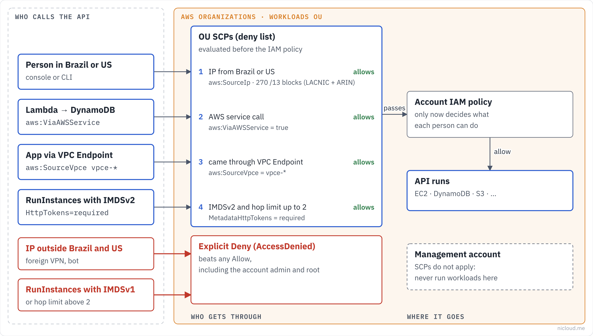

<!-- curso: Nicloud · AWS Security -->
# Module 1 – Service Control Policies in Practice

## Learning objectives

In this module, you will learn how to:

- Describe what a **Service Control Policy (SCP)** does and what it does not do.
- Differentiate an SCP from an IAM policy.
- Explain why the SCPs in this repository use **Deny** instead of Allow.
- Read SCP conditions (`StringNotEquals`, `NumericGreaterThan`, `NotIpAddress`, `BoolIfExists`).
- Require **IMDSv2** on every EC2 instance in the organization.
- Build a country-based block without breaking AWS service-to-service calls.
- Respect the SCP size limit and check it when it changes.

## Architecture

Overview of what this repository does, in the Nicloud diagram style: callers on the left, rules in the middle, destinations on the right.



## Service Control Policies (SCP)

A <u>**Service Control Policy**</u> is an **AWS Organizations** rule that sets the **maximum permissions** the accounts in an organizational unit (OU) can have. It never grants access: it only takes it away.

Think of the SCP as the ceiling of a building. IAM policies decide what each person can do inside, but nobody goes through the ceiling, not even the root user of a member account.

- An action is allowed only if **both the SCP and the IAM policy allow it**.
- SCPs do not apply to the organization's **management account**.
- SCPs do not apply to **service-linked roles**.

### When to use

Use SCPs for rules that **no** account may break, by mistake or with admin access: allowed regions, mandatory encryption, instance security standards, source restrictions.

## Why Deny instead of Allow

This repository follows a **deny list** strategy: the default `FullAWSAccess` SCP stays attached and each file here adds one specific **Deny**. An explicit Deny always wins over any Allow.

The alternative (an allow list, which removes `FullAWSAccess` and lists only what is permitted) gives more control, but every new service requires an SCP change. For a reusable library, the deny list is safer to roll out without blocking anyone.

## Requiring IMDSv2

The <u>**Instance Metadata Service (IMDS)**</u> lives at `169.254.169.254` and lets an instance read data about itself, including the **temporary credentials of its role**. Version 1 answers a plain GET, so an **SSRF** attack (tricking the application into making a request) can steal those credentials. **Version 2** requires a token obtained first with a PUT.

## Example: IMDSv2 in this repo

```json
// policies/imdsv2-enforcement/enforce-imdsv2.json
{
  "Sid": "RequireIMDSv2OnRunInstances",
  "Effect": "Deny",
  "Action": "ec2:RunInstances",
  "Resource": "arn:aws:ec2:*:*:instance/*",
  "Condition": {
    "StringNotEquals": { "ec2:MetadataHttpTokens": "required" }
  }
}
```

### How it works

#### (1) Require the token

The first statement denies `RunInstances` when `MetadataHttpTokens` is not `required`. New instances can only launch with IMDSv2.

#### (2) Limit the hops

The second statement denies when `MetadataHttpPutResponseHopLimit` is greater than **2**. The hop limit is how many network hops the token response survives. With 2, a container on the instance can still reach IMDS; with more, it gets easier for the token to leak out.

### What it does not cover

This SCP applies to **new** instances. Existing IMDSv1 instances stay as they are: migrate them with `modify-instance-metadata-options` and, to stop anyone from switching back, also deny that action when the value is not `required`.

## Country-based block

The second policy denies API calls coming from IPs outside Brazil and the United States. The main condition is <u>**`NotIpAddress`**</u> on `aws:SourceIp`: if the source IP is **not** on the list, the call is denied.

The catch is that not every call carries a person's IP. When Lambda calls DynamoDB, or ECS pulls an image from ECR, the caller is AWS itself.

## Example: the exceptions that keep AWS working

```json
// policies/geo-restriction/deny-access-from-non-allowed-countries.json
"Condition": {
  "NotIpAddress":   { "aws:SourceIp": ["177.0.0.0/13", "..."] },
  "BoolIfExists":   { "aws:ViaAWSService": "false" },
  "StringNotLike":  { "aws:SourceVpce": "vpce-*" }
}
```

All three conditions must be true for the Deny to apply:

| Condition | What it guarantees |
|---|---|
| `NotIpAddress` | the IP is outside the allowed list |
| `BoolIfExists` `aws:ViaAWSService: false` | it is not an AWS service calling on someone's behalf |
| `StringNotLike` `aws:SourceVpce: vpce-*` | it did not come through a VPC Endpoint (which has no public IP) |

### Where the IPs come from

`generate-country-cidrs.sh` downloads the delegation files from the regional registries (**LACNIC** for Brazil, **ARIN** for the United States), filters by country and aggregates the blocks into **/13**.

## SCP size limit

Today an SCP accepts up to **10,240 characters** (the 5,120 limit applies to **Resource Control Policies**). In the console, whitespace between JSON elements is removed and not counted; through the CLI or SDK the text is saved as is and everything counts.

The country-block file is 8,375 characters formatted and **4,691 minified**. Both fit today. The **/13** blocks were chosen when the limit was 5,120: with the current limit, smaller and more precise blocks are possible, letting in fewer IPs from neighboring countries.

### Lesson

Service limits change. Before making a trade-off because of a limit, check the number in today's documentation and write the date in the README.

## Summary

An **SCP** is the permission ceiling for the accounts in an organization: it only takes away, never grants, and it binds even the member account's root user. This repository uses a **deny list** strategy, keeping `FullAWSAccess` and adding specific denies.

The **IMDSv2** policy prevents instances from launching with version 1 of the metadata service, the most common path to credential theft through **SSRF**, and caps the **hop limit** at 2.

The **country-block** policy denies calls from outside Brazil and the United States, but only after excluding calls from **AWS services** and **VPC Endpoints**. Without those two exceptions, it would take down your own infrastructure.

And every SCP must fit in **10,240 characters**: minify the JSON when sending it through the CLI, because whitespace counts there.

## Quiz

An admin in a member account has `AdministratorAccess` but cannot launch an instance. The IAM policy is correct. What should you check?

- An SCP on the account's OU. SCPs limit even admins and the member account's root user.

You must ensure no new instance in the organization uses IMDSv1. Which condition goes in the Deny on `ec2:RunInstances`?

- `StringNotEquals` on `ec2:MetadataHttpTokens` with the value `required`.

After applying the country block, Lambda stopped writing to DynamoDB. Which exception is probably missing?

- `aws:ViaAWSService`. The call comes from the service, not from a person's IP.

An SCP with 11,000 formatted characters fails when saved through the CLI, but the minified content has 9,000. What do you do?

- Minify the JSON before sending it. Whitespace counts in the CLI; the SCP limit is 10,240 characters.

Does the IMDSv2 SCP fix existing IMDSv1 instances?

- No. It only applies to `RunInstances`. Existing instances must be migrated with `modify-instance-metadata-options`.

Do SCPs apply to the organization's management account?

- No. That is why nothing should run in the management account besides administering the organization.

## Additional resources

- [Service control policies (AWS Organizations)](https://docs.aws.amazon.com/organizations/latest/userguide/orgs_manage_policies_scps.html)
- [SCP examples](https://docs.aws.amazon.com/organizations/latest/userguide/orgs_manage_policies_scps_examples.html)
- [AWS Organizations quotas](https://docs.aws.amazon.com/organizations/latest/userguide/orgs_reference_limits.html)
- [Configure the instance metadata service (IMDS)](https://docs.aws.amazon.com/AWSEC2/latest/UserGuide/configuring-instance-metadata-service.html)
- [IAM global condition keys](https://docs.aws.amazon.com/IAM/latest/UserGuide/reference_policies_condition-keys.html)
