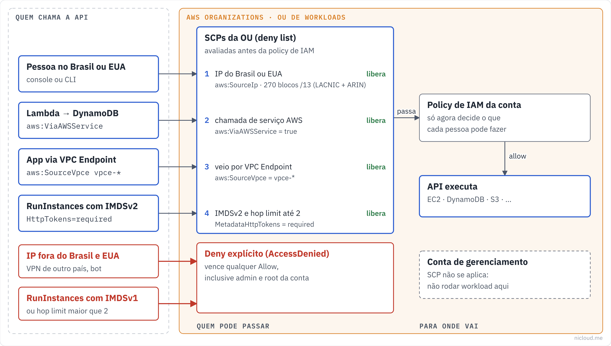

<!-- curso: Nicloud · Segurança na AWS -->
# Módulo 1 – Service Control Policies na prática

## Objetivos de aprendizagem

Neste módulo, você vai aprender a:

- Descrever o que uma **Service Control Policy (SCP)** faz e o que ela não faz.
- Diferenciar uma SCP de uma policy de IAM.
- Explicar por que as SCPs deste repositório usam **Deny** e não Allow.
- Ler uma condição de SCP (`StringNotEquals`, `NumericGreaterThan`, `NotIpAddress`, `BoolIfExists`).
- Exigir **IMDSv2** em todas as instâncias EC2 da organização.
- Montar um bloqueio por país sem quebrar chamadas entre serviços da AWS.
- Respeitar o limite de tamanho de uma SCP e conferir quando ele muda.

## Arquitetura

Visão geral do que este repositório faz, no padrão de diagrama da Nicloud: à esquerda quem chama, no meio as regras, à direita para onde vai.



## Service Control Policies (SCP)

Uma <u>**Service Control Policy**</u> é uma regra do **AWS Organizations** que define o **máximo de permissão** que as contas de uma unidade organizacional (OU) podem ter. Ela não dá permissão a ninguém: só tira.

Pense na SCP como o teto do prédio. A policy de IAM decide o que cada pessoa pode fazer lá dentro, mas ninguém passa do teto, nem o usuário root da conta-membro.

- Uma ação só acontece se **a SCP permite e a policy de IAM permite**.
- A SCP não vale para a **conta de gerenciamento** da organização.
- A SCP não vale para **service-linked roles**.

### Quando usar

Use SCP para regras que **nenhuma** conta pode quebrar, nem por engano, nem com acesso de administrador: região permitida, criptografia obrigatória, padrão de segurança de instância, bloqueio de origem.

## Por que Deny e não Allow

A estratégia deste repositório é a **deny list**: a SCP padrão `FullAWSAccess` continua anexada e cada arquivo daqui acrescenta um **Deny** específico. O Deny explícito sempre vence qualquer Allow.

A alternativa (allow list, que tira o `FullAWSAccess` e lista só o permitido) dá mais controle, mas cada serviço novo exige mudar a SCP. Para uma biblioteca reutilizável, a deny list é mais segura de aplicar sem parar ninguém.

## Exigir IMDSv2

O <u>**Instance Metadata Service (IMDS)**</u> é o endereço `169.254.169.254` de onde a instância lê dados sobre si mesma, inclusive as **credenciais temporárias da role**. A versão 1 responde a um GET simples, e por isso um ataque de **SSRF** (a aplicação é enganada a fazer uma requisição) consegue roubar as credenciais. A **versão 2** exige um token obtido antes com um PUT.

## Exemplo: IMDSv2 neste repo

```json
// policies/imdsv2-enforcement/enforce-imdsv2.json
{
  "Sid": "RequireIMDSv2OnRunInstances",
  "Effect": "Deny",
  "Action": "ec2:RunInstances",
  "Resource": "arn:aws:ec2:*:*:instance/*",
  "Condition": {
    "StringNotEquals": { "ec2:MetadataHttpTokens": "required" }
  }
}
```

### Como funciona

#### (1) Exigir o token

O primeiro statement nega o `RunInstances` quando `MetadataHttpTokens` não é `required`. Instância nova só nasce com IMDSv2.

#### (2) Limitar os saltos

O segundo statement nega quando `MetadataHttpPutResponseHopLimit` passa de **2**. O hop limit é quantos "pulos" de rede a resposta do token aguenta. Com 2, um container na instância ainda alcança o IMDS; com mais que isso, fica mais fácil o token escapar para fora.

### O que fica de fora

Esta SCP vale para instâncias **novas**. Instâncias antigas com IMDSv1 continuam como estão: é preciso migrar com `modify-instance-metadata-options` e, para impedir a volta, negar também essa ação quando o valor não for `required`.

## Bloqueio por país

A segunda policy nega chamadas de API que venham de IPs fora do Brasil e dos Estados Unidos. A condição principal é <u>**`NotIpAddress`**</u> com `aws:SourceIp`: se o IP de origem **não** está na lista, a chamada é negada.

O problema é que nem toda chamada tem o IP de uma pessoa. Quando a Lambda chama o DynamoDB, ou quando o ECS baixa uma imagem do ECR, quem chama é a própria AWS.

## Exemplo: as exceções que não quebram a AWS

```json
// policies/geo-restriction/deny-access-from-non-allowed-countries.json
"Condition": {
  "NotIpAddress":   { "aws:SourceIp": ["177.0.0.0/13", "..."] },
  "BoolIfExists":   { "aws:ViaAWSService": "false" },
  "StringNotLike":  { "aws:SourceVpce": "vpce-*" }
}
```

As três condições precisam ser verdadeiras ao mesmo tempo para o Deny valer:

| Condição | O que garante |
|---|---|
| `NotIpAddress` | o IP está fora da lista permitida |
| `BoolIfExists` `aws:ViaAWSService: false` | não é um serviço da AWS chamando em nome de alguém |
| `StringNotLike` `aws:SourceVpce: vpce-*` | não veio por VPC Endpoint (que não tem IP público) |

### De onde vêm os IPs

O script `generate-country-cidrs.sh` baixa a lista de delegações dos registros regionais (**LACNIC** para o Brasil, **ARIN** para os Estados Unidos), filtra pelo país e agrega os blocos em **/13**.

## Limite de tamanho da SCP

Hoje uma SCP aceita até **10.240 caracteres** (o limite de 5.120 vale para as **Resource Control Policies**). Pelo console, os espaços e quebras de linha entre os elementos do JSON são removidos e não contam; pela CLI ou SDK, o texto é salvo como está e tudo conta.

O arquivo do bloqueio por país tem 8.375 caracteres formatado e **4.691 minificado**. Os dois cabem hoje. A escolha por blocos **/13** foi feita quando o limite era 5.120: com o limite atual, dá para usar blocos menores e mais precisos, que incluem menos IPs de países vizinhos.

### Lição

Limite de serviço muda. Antes de decidir um trade-off por causa de um limite, confira o número na documentação do dia e anote a data no README.

## Resumo

Uma **SCP** é o teto de permissão das contas de uma organização: ela só tira, nunca dá, e vale até para o root da conta-membro. Este repositório usa a estratégia de **deny list**, mantendo o `FullAWSAccess` e somando negações específicas.

A policy de **IMDSv2** impede que nasça instância com a versão 1 do serviço de metadados, que é a porta de entrada mais comum para roubo de credencial via **SSRF**, e limita o **hop limit** a 2.

A policy de **bloqueio por país** nega chamadas de fora do Brasil e dos Estados Unidos, mas só depois de excluir chamadas de **serviços da AWS** e de **VPC Endpoints**. Sem essas duas exceções, ela derrubaria a própria infraestrutura.

E toda SCP precisa caber em **10.240 caracteres**: minifique o JSON quando enviar pela CLI, porque ali os espaços contam.

## Quiz

Um administrador da conta-membro tem `AdministratorAccess`, mas não consegue criar uma instância. A policy de IAM está certa. O que verificar?

- Uma SCP na OU da conta. A SCP limita até o administrador e o root da conta-membro.

Você precisa garantir que nenhuma instância nova da organização use IMDSv1. Qual condição usar no Deny de `ec2:RunInstances`?

- `StringNotEquals` em `ec2:MetadataHttpTokens` com valor `required`.

Depois de aplicar o bloqueio por país, a Lambda parou de gravar no DynamoDB. Qual exceção provavelmente falta?

- `aws:ViaAWSService`. A chamada vem do serviço, não do IP de uma pessoa.

Uma SCP com 11.000 caracteres formatados dá erro ao salvar pela CLI, mas o conteúdo minificado tem 9.000. O que fazer?

- Minificar o JSON antes de enviar. Pela CLI os espaços contam; o limite da SCP é 10.240 caracteres.

A SCP de IMDSv2 resolve as instâncias que já existem com IMDSv1?

- Não. Ela só vale para `RunInstances`. As instâncias antigas precisam ser migradas com `modify-instance-metadata-options`.

A SCP vale para a conta de gerenciamento da organização?

- Não. Por isso nada deve rodar na conta de gerenciamento além da própria administração da organização.

## Recursos adicionais

- [Service control policies (AWS Organizations)](https://docs.aws.amazon.com/organizations/latest/userguide/orgs_manage_policies_scps.html)
- [Exemplos de SCP](https://docs.aws.amazon.com/organizations/latest/userguide/orgs_manage_policies_scps_examples.html)
- [Limites do AWS Organizations](https://docs.aws.amazon.com/organizations/latest/userguide/orgs_reference_limits.html)
- [Configurar o serviço de metadados da instância (IMDS)](https://docs.aws.amazon.com/AWSEC2/latest/UserGuide/configuring-instance-metadata-service.html)
- [Chaves de condição globais do IAM](https://docs.aws.amazon.com/IAM/latest/UserGuide/reference_policies_condition-keys.html)
